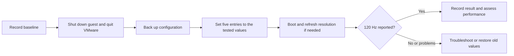

<div align="center">

# VMware at 120 Hz

### A reproducible guide from a verified VMware Fusion experiment.

**60 Hz → 120 Hz · Apple Silicon · Windows 11 ARM**

[](docs/testing.md)
[](examples/120hz.vmx.txt)
[](#what-this-project-proves)
[](LICENSE)

[Mac walkthrough](#mac-walkthrough-vmware-fusion) · [Windows / Linux hosts](docs/workstation.md) · [Troubleshooting](docs/troubleshooting.md) · [Undo](docs/rollback.md) · [Report your result](https://github.com/Nihal0801/vmware-120hz-guide/issues/new/choose)

</div>

Windows inside VMware Fusion was offering only **60 Hz**, even though the Mac's built-in display already had ProMotion enabled. After changing five VM configuration entries, restarting the VM, and refreshing its resolution, Windows reported **3600 × 2260 at 120 Hz** for both **Desktop mode** and **Active signal mode**.

This repository documents the exact change, the sequence that worked, and how to reverse it. **Tested and visually verified on one Apple Silicon Mac.** Windows and Linux host users running VMware Workstation can also try the documented procedure and contribute their results; those combinations have not been independently tested by this project.

> [!IMPORTANT]
> Verification here means **Windows displayed a 120 Hz mode**. We have not measured 120 distinct frames per second reaching the physical display, game FPS, input latency, battery impact, or long-term stability. This is a community workaround, not a VMware/Broadcom-supported fix.

> [!WARNING]
> **Restart persistence issue confirmed by the maintainer:** Windows returns to 60 Hz after restart even though the five entries remain saved. The resolution-change trigger may be needed again. This is currently a session workaround, not a verified automatic or permanent fix. An automatic activation method is being investigated and is not yet available or verified.

## Start here

| Your setup | Where to go |
| --- | --- |
| Mac + VMware Fusion + Windows guest | [Follow the Mac walkthrough](#mac-walkthrough-vmware-fusion) |
| Windows or Linux host + VMware Workstation | [Follow the Workstation adaptation](docs/workstation.md) |
| Want the exact five lines | [Configuration snippet](examples/120hz.vmx.txt) |
| Want to understand the method | [Settings, reasoning, and algorithm](docs/how-it-works.md) |
| Still seeing 60 Hz or experiencing issues | [Troubleshooting](docs/troubleshooting.md) |
| Want to return to your previous setup | [Rollback guide](docs/rollback.md) |
| Want proof and test details | [Verification record](docs/testing.md) |

## What this project proves

| Observation | Before | After |
| --- | --- | --- |
| Windows desktop mode | 3600 × 2260, 60 Hz | **3600 × 2260, 120 Hz** |
| Windows active signal mode | 60 Hz in the initial display setup | **3600 × 2260, 120 Hz** |
| Selected Windows refresh rate | 60 Hz | **120 Hz** |
| Mac display setting | ProMotion enabled | Already enabled; no change needed |
| Variable refresh rate inside the guest | Not supported | Still not supported |

The maintainer reported 120 Hz and the final Windows **Advanced display** page was independently inspected during the session on **November 12, 2026**. Screenshots are deferred and are **not included in this release**. The table records the observation; it is not a screenshot or performance benchmark. See the [full test record and limits](docs/testing.md).

## The exact configuration

Add or update these entries in the **existing target VM's `.vmx` file on the host**:

```ini
guestinfo.svga.wddm.vsyncDefaultHz = "120"
guestinfo.svga.wddm.vsyncMaxHz = "120"
guestinfo.svga.wddm.vsyncThread = "TRUE"
mks.lowCompositingFPS = "120"
mks.maxCompositingFPS = "120"
```

**Do not replace the entire `.vmx` file with this snippet.** Keep exactly one active entry for each of these keys. Use ordinary straight quotes, preserve unrelated settings, and edit only after a complete guest shutdown and after quitting VMware.

The four numeric values were all set to `120` in our test. Other refresh rates are unverified by this project. A physical display limited to 60 Hz cannot show 120 distinct refreshes each second merely because a VM reports 120 Hz.

## Before you begin

- Save your guest work and allow any active Windows updates to finish.
- Confirm the physical display and host display mode support your intended refresh rate. On our Mac, ProMotion was already enabled.
- Confirm VMware Tools is installed and Windows uses **VMware SVGA 3D**. Our VM already had 3D acceleration and Retina support enabled. These are recorded test conditions, not proven universal requirements.
- Back up the VM's data. A copy of its `.vmx` file protects configuration only; it does **not** back up the virtual disk or personal files.
- Record the current resolution, refresh rate, and any existing values of the five keys above.

Broadcom's [Fusion configuration-editing guidance](https://knowledge.broadcom.com/external/article/330654/editing-the-vmx-file-for-vmware-fusion-v.html) describes backing up the VM and configuration before editing. It supports the editing procedure, **not these experimental refresh-rate settings**.

## Mac walkthrough: VMware Fusion

### 1. Record your baseline

Inside Windows, open **Settings → System → Display → Advanced display**. Select the relevant display if more than one is listed. Write down:

- Desktop mode and active signal mode.
- The selected refresh rate and available choices.
- The display adapter name.

On macOS, open **System Settings → Displays** and check the host refresh-rate setting. Use ProMotion where available or a supported high-refresh fixed mode for your display. Record your original setting before changing it.

### 2. Shut down cleanly

Shut down Windows through its Start menu or Fusion's normal **Shut Down** command. Wait until the VM is fully off. **Suspending or pausing is not sufficient.**

Locate the VM package through Fusion's library/Finder, then **quit VMware Fusion completely**. In our session, shutdown alone left a configuration lock until Fusion exited. If lock files or directories remain, investigate the running VM/application; do not delete locks to force the edit.

### 3. Find and back up the configuration

In Finder, locate the target `.vmwarevm` package. A common location is a **Virtual Machines** folder in your home folder, but use the actual location of your VM.

1. Right-click the package and choose **Show Package Contents**.
2. Locate the `.vmx` file for that VM. Do not select a virtual disk such as `.vmdk`.
3. Copy the `.vmx` file to a safe location **outside the VM package**, giving the backup a descriptive date and name.
4. Keep a note of where the backup belongs. Do not open the backup as a new VM.

If the configuration is inaccessible because of encryption or permissions, use Fusion's supported access flow. Do not disable encryption, remove a virtual TPM, or change credentials for this tweak. A Windows sign-in password is not necessarily the VM encryption password.

### 4. Edit only the five entries

Open the original `.vmx` in a plain-text editor. If using TextEdit, use plain text and turn off **Smart Quotes**. Do not save it as rich text or append `.txt` to the actual VM configuration filename.

Search for each key in [the configuration block](#the-exact-configuration):

- If it exists, record its old value and replace that entry.
- If it is absent, append the new entry.
- If it appears more than once, resolve it to one entry, retaining the originals in your backup.

Save the file and close the editor. Reopen it briefly to confirm the five entries are present exactly as shown and that unrelated configuration remains intact.

### 5. Start Windows and refresh its resolution

Open Fusion and start the same VM normally. Let Windows reach its desktop and finish any pending update/restart cycle.

Check **Advanced display** first. If it still shows 60 Hz:

1. Note your current Windows display resolution.
2. In **Settings → System → Display**, temporarily select another supported resolution and apply it.
3. Return to the original resolution and apply it again.
4. If a confirmation appears, confirm only when the image is usable; otherwise let the display change revert.

This resolution change was the activation step used in the successful session. Fusion's **View → Resize Virtual Machine to Fit** was also used to restore the full-size guest view. The final verified resolution was **3600 × 2260**, so the result was not left at a reduced resolution.

### 6. Verify the result

Return to **Advanced display** and inspect **both** mode fields and the selected refresh rate:

```text
Desktop mode:       3600 × 2260, 120 Hz
Active signal mode: 3600 × 2260, 120 Hz
Choose a refresh rate:          120 Hz
```

Those numbers describe our result; your resolution can differ. If 120 Hz is available but not selected, select it and verify again. If it is absent, follow [troubleshooting](docs/troubleshooting.md).

Record your result and observe CPU usage and responsiveness during normal work. For a claim about delivered frame rate, perform a separate frame-timing or frame-skipping test; the Settings page alone is not enough. See [verification levels](docs/testing.md#verification-levels).

## Tested setup and compatibility

| Host / product / guest | Evidence | Result |
| --- | --- | --- |
| Apple M5 Pro Mac, macOS 27.0.1 / Fusion 26.0.0 / Windows 11 Home ARM | Direct session observation | **120 Hz display mode verified** |
| Windows 11 host / Workstation 17.5.1 / Windows 11 and Ubuntu guests | Original workaround author's report | Reported working; not reproduced here |
| Another macOS setup | Comment on the original source; versions unspecified | Reported 120 Hz; not independently verified here |
| Other Mac/Fusion versions; Workstation on Linux; other guests | No project test yet | Experimental; reports welcome |
| Parallels, VirtualBox, Hyper-V, UTM, ESXi | Outside this guide's scope | Do not assume these settings apply |

The Windows/Ubuntu and additional Mac reports come from the [original firsthand discussion](https://www.reddit.com/r/vmware/comments/1x64h5x/vmware_workstation_refresh_rate_fix/). This project does not claim multiple independently verified Macs or universal compatibility.

## How the method works



The `guestinfo.svga.wddm.*` entries appear intended to influence Windows guest graphics timing; the `mks.*` entries appear intended to influence VMware compositing cadence. Their precise internal behavior is not established by this project. We tested the five-entry combination, not each setting in isolation. [Read the algorithm and evidence boundaries →](docs/how-it-works.md)

## Undo, known limits, and support

To undo, fully shut down the guest and quit VMware again. Restore the previous values of these five entries, removing only entries that were originally absent. This preserves later unrelated configuration changes. See [the complete rollback procedure](docs/rollback.md).

- Higher CPU use in a Windows guest was reported by the original workaround author. CPU and battery impact were not benchmarked in our Mac session.
- VRR/DRR remained unsupported in our Windows guest. Fixed 120 Hz does not imply adaptive refresh support.
- A future Fusion, Tools, or driver update may change the result. Recheck after updates.
- Persistence across subsequent cold boots, suspend/resume, and monitor changes has not been established here.

Use the [result-report form](https://github.com/Nihal0801/vmware-120hz-guide/issues/new?template=compatibility.yml) to share success or failure, or the [troubleshooting form](https://github.com/Nihal0801/vmware-120hz-guide/issues/new?template=problem.yml) for an issue. **Never upload your full VM, `.vmx`, credentials, or unredacted logs.**

## Repository map

```text
README.md                    Complete Mac walkthrough
examples/120hz.vmx.txt        The five-line snippet; not a full VM config
docs/how-it-works.md          Reasoning and reproducible algorithm
docs/testing.md               Test conditions, observations, and limits
docs/workstation.md           Windows / Linux host adaptation
docs/troubleshooting.md       Symptoms and next actions
docs/rollback.md              Restore the previous configuration
docs/screenshots.md           Screenshot plan for a later update
CONTRIBUTING.md               How to contribute useful evidence
scripts/check_docs.py         Repository checks; never edits a VM
```

## Credit and references

The five-setting workaround and resolution-change trigger came from **u/Vegetable-Writer-629** in [VMware Workstation Refresh Rate Fix](https://www.reddit.com/r/vmware/comments/1x64h5x/vmware_workstation_refresh_rate_fix/). This repository contributes the documented Fusion reproduction, careful verification scope, rollback instructions, and reporting structure. It does not claim discovery of the original workaround.

Official references for configuration editing:

- [Broadcom: editing a Fusion `.vmx` file](https://knowledge.broadcom.com/external/article/330654/editing-the-vmx-file-for-vmware-fusion-v.html)
- [Broadcom: editing a Workstation / Player `.vmx` file](https://knowledge.broadcom.com/external/article/311480/editing-the-vmx-file-of-a-vmware-worksta.html)

Maintained by [Nihal Patel](https://github.com/Nihal0801). Documentation and original repository materials are available under the [MIT License](LICENSE). VMware product names belong to their respective owners; this project is independent and is not affiliated with or endorsed by Broadcom.
